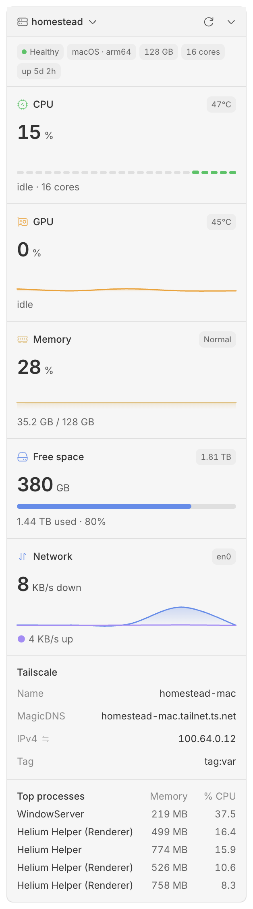
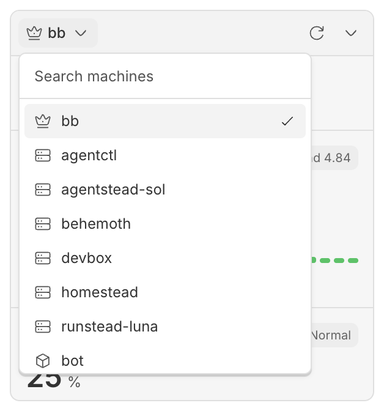
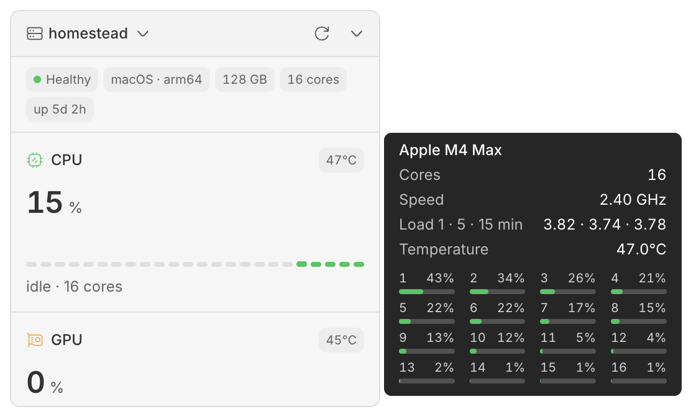

# Machine status

See CPU, GPU, memory, disk, network, battery, Tailscale and top processes for any of your bb machines, from the bb sidebar footer.

Based on Beacon by [g4f4r0](https://github.com/g4f4r0/bb-plugins).

<p>
  <picture>
    <source media="(prefers-color-scheme: dark)" srcset="assets/screenshots/panel-dark.png">
    
  </picture>
  <picture>
    <source media="(prefers-color-scheme: dark)" srcset="assets/screenshots/picker-dark.png">
    
  </picture>
</p>

<picture>
  <source media="(prefers-color-scheme: dark)" srcset="assets/screenshots/tooltip-dark.png">
  
</picture>

## What it shows

Open Machine status from the sidebar footer and pick a machine from the menu at the top. The bb server has a crown, your own machines a server icon and BB Box boxes the BB Box cube. The list searches as you type.

For the selected machine you see:

- a summary: health, operating system, memory, cores, uptime and, for the bb server, how long bb has been running
- CPU usage with recent history, load, and temperature on Apple silicon Macs
- GPU usage, temperature and power on Apple silicon Macs
- memory used, with pressure
- free space on `/`
- network download and upload rates
- battery charge, state, time left and health on Mac and Linux laptops
- Tailscale machine name, MagicDNS name, IPv4 or IPv6 address and tags, each with a copy button
- the top five processes by CPU, with memory and CPU coloured when high

Hover a section for more detail, such as per-core usage, swap, mount point or totals sent and received. Values that are slow to arrive show as placeholders in the same place, so nothing moves when they land.

The panel only reads data while it is open and visible. It reads system counters only. It does not change settings, enable swap, kill processes or call an outside service.

## Install

```sh
bb plugin install git:https://github.com/ahkohd/bb-plugin-machine-status.git
```

Needs bb 0.46 and Plugin SDK 0.6.49 or newer. Each machine is read by the plugin's host entry, which bb runs on that machine. Linux, macOS and WSL are supported.

## Settings

| Setting | Default | Effect |
| --- | --- | --- |
| `refreshIntervalSeconds` | `5` | How often the panel refreshes, from 2 to 60 seconds. |
| `backgroundMonitoring` | `false` | Checks the bb server's CPU and memory while the panel is closed, and keeps diagnostic logs. |
| `pressureNotifications` | `true` | Shows an in-app alert when background monitoring finds sustained high CPU or memory. |

```sh
bb plugin config machine-status
bb plugin config machine-status set refreshIntervalSeconds 10
bb plugin config machine-status set backgroundMonitoring true
```

Settings apply without a reload.

## Commands

These read the bb server only.

| Command | Result |
| --- | --- |
| `bb machine-status snapshot` | CPU, load, memory, disk and process summary. Add `--json` for the full reading. |
| `bb machine-status health` | Pressure assessment. Exits 2 if critical. With `--json` it always exits 0; read `status`. |
| `bb machine-status logs` | The last 100 diagnostic records. `--limit 500 --json` gives up to 500 as JSONL. |
| `bb machine-status test-alert` | Shows a labelled preview alert on open bb clients. Needs both monitoring settings on. |

## Background alerts

When background monitoring is on, the bb server checks its own CPU and memory every 30 seconds.

- A CPU incident starts after 60 seconds at 95% or more, and ends after 60 seconds at 85% or less.
- A memory incident starts after 60 seconds at 90% or more, and ends after 60 seconds at 85% or less.

You get one alert when an incident starts and one when it ends, then a five-minute pause for that metric. bb must be open and visible to show them. There are no system notifications.

The panel colours, `health` command and alerts use different thresholds on purpose. The panel turns amber at 75% and red at 95%. `health` warns at 85%, is critical at 95%, and also compares five-minute load with the number of cores.

## How the numbers are read

**CPU** is the change in CPU time between two readings. When the panel opens cold, the plugin reads everything else first and then takes a 300 ms baseline, so the first reading has a value and does not include the plugin's own work.

**Memory** used is total minus available. On Linux, available is `MemAvailable`. On macOS it matches Activity Monitor's Memory Used: app memory less purgeable, plus wired and compressed memory, from `vm_stat`.

**Disk** is the root filesystem. Available space excludes reserved blocks, so used plus available may not equal total.

**Network** is bytes per second on the busiest non-loopback interface. Linux reads `/proc/net/dev` and macOS `netstat -ibn`. On WSL it adds up Windows' interfaces from `netsh.exe interface ipv4 show subinterfaces`, whose counters are 64-bit. Rates are unavailable for one reading after an interface change or a counter reset.

**Processes** are ranked by CPU. Process CPU is relative to one core, so it can go above 100%. Sizes use powers of 1024.

**Battery** comes from `ioreg` on macOS and `/sys/class/power_supply` on Linux. Desktop Macs report an empty battery record, which is ignored, and so are mouse and headset batteries on Linux.

**Tailscale** comes from `tailscale status --json`, read at most once a minute. It finds the command on `PATH`, in the macOS app, or as the Windows program under WSL.

## The Mac sensor helper

Temperature, power and GPU usage on Apple silicon come from a small helper, `native/sensors.c`. It reads temperatures from the SMC, power from IOReport energy counters and GPU usage from the GPU's IOKit statistics. None of these need root.

`native/build.sh` builds it on an Apple silicon Mac and embeds it in `lib/mac-sensors-binary.ts` with its SHA-256. Rebuild it whenever the C source changes. A test fails if the embedded helper and its hash disagree.

The plugin writes the helper to `~/Library/Caches/bb-plugin-machine-status`, which only the user can write to. It checks the file's owner, permissions and hash, then starts it once. The helper keeps its sensor connections open and answers one reading for each line it gets on stdin, so a refresh starts no new process.

- Power is averaged over the time since the previous reading. The first reading has none, and neither does a reading more than 65 seconds after the last one, for example after the Mac slept.
- Counters that report no energy at all are shown as unavailable, not as 0 W. Some machines report CPU energy this way.
- If the helper exits or does not answer within 3 seconds, the plugin stops it and starts a new one. A helper problem only empties the sensor values. It never fails the rest of the reading.
- Helper files from other versions are removed once they are a day old. The helper stops when the plugin is unloaded.

## Develop

```sh
npm test
npm run typecheck
bb plugin build
bb plugin reload machine-status
```

Tests live in `tests/`. `tests/monitor.test.mjs` needs `better-sqlite3`'s native module, built for your Node version.

## Troubleshooting

**A machine is missing from the list.** Only connected machines are listed. Open the list again to refresh it.

**The panel says it is still waiting for a machine.** The machine has not answered yet. Just after a plugin update, bb can take about a minute to start the plugin on each machine.

**The panel says it cannot reach a machine.** The last reading stays visible while the plugin keeps trying. Failed requests are logged in `bb plugin logs machine-status`.

**No temperature or power on a Mac.** These need an Apple silicon Mac. Some machines report no CPU energy, so CPU power stays hidden there.

**No alert appeared.** Check both monitoring settings and keep bb visible. Try `bb machine-status test-alert`. Real alerts also wait a minute to confirm and then pause for five minutes.
