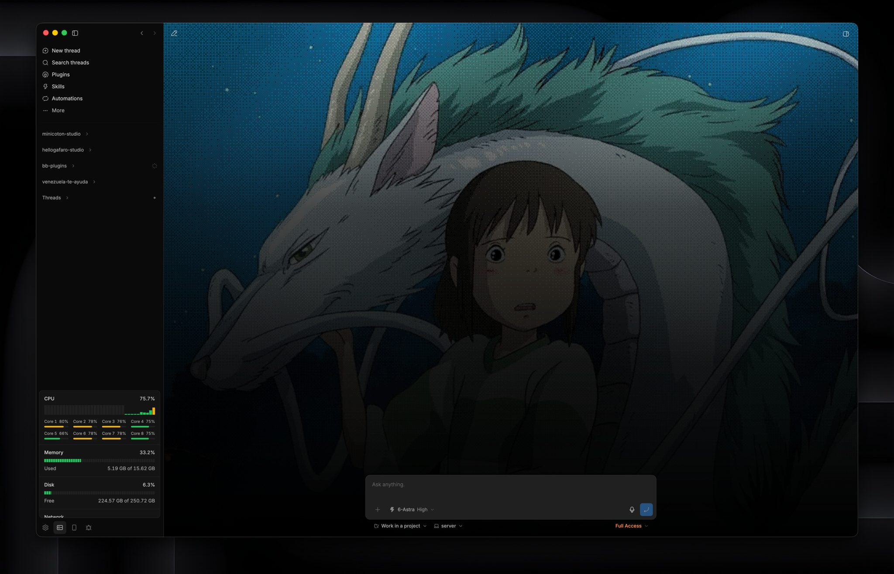

# Machine status

See CPU, GPU, memory, disk, network, battery and processes for any of your bb machines from the footer.

Based on Beacon by [g4f4r0](https://github.com/g4f4r0/bb-plugins).



Status sits in the sidebar footer. Open it while you work. An optional background monitor can toast when CPU or memory stays high. The two collectors do not share a timer.

The plugin reads system counters. It does not change settings, enable swap, kill processes, or call a monitoring service. Pick a machine from the menu at the top of the panel. The bb server is marked with a crown, your own machines with a server icon and BB Box boxes with BB Box's cube. Other machines are read by the plugin's host entry, which bb runs on each machine. Container cgroup limits are not shown.

Needs BB 0.46 and Plugin SDK 0.6.49.

## Install

```sh
bb plugin install git:https://github.com/ahkohd/bb-plugin-machine-status.git
```

Reload after a source change:

```sh
bb plugin build
bb plugin reload machine-status
```

## Settings

| Setting | Default | Effect |
| --- | --- | --- |
| `refreshIntervalSeconds` | `5` | Dashboard interval, integer 2 to 60. |
| `backgroundMonitoring` | `false` | Unattended CPU and memory checks plus diagnostic logs. |
| `pressureNotifications` | `true` | In-app toasts when monitoring is on. |

```sh
bb plugin config machine-status
bb plugin config machine-status set refreshIntervalSeconds 10
bb plugin config machine-status set backgroundMonitoring true
bb plugin config machine-status set pressureNotifications false
```

Settings apply without a reload. The dashboard interval does not change the monitor's 30-second cadence. Turning monitoring off cancels its timer and leaves existing logs.

## Commands

| Command | Result |
| --- | --- |
| `bb machine-status snapshot` | CPU, load, memory, disk, and process summary. |
| `bb machine-status snapshot --json` | Full snapshot, including recent chart history. |
| `bb machine-status health` | Pressure assessment. Exit 2 if critical. |
| `bb machine-status health --json` | Structured assessment. Exit 0 always; read `status`. |
| `bb machine-status logs` | Last 100 diagnostic records. |
| `bb machine-status logs --limit 500 --json` | Up to 500 records as JSONL, oldest first in that window. |
| `bb machine-status test-alert` | Labeled toast preview on visible BB clients. |

`test-alert` needs monitoring and notifications both on. It does not create load, incidents, or log rows. It broadcasts to every connected client.

CLI snapshots share the dashboard collector. Repeated calls keep history alive. Reading logs does not.

## Machine details

- **Battery** on macOS (`ioreg`) and Linux (`/sys/class/power_supply`): charge, state, time left, health from full and design capacity, cycles and power. macOS also gives the battery temperature.
- **CPU and GPU temperature and power on Apple silicon Macs**, plus GPU usage. Temperature comes from the SMC, power from IOReport energy counters, and GPU usage from the GPU's IOKit statistics. None need root.
- **Tailscale** name, address and tags, read from `tailscale status --json` once a minute, with copy buttons.
- **WSL** machines show Windows' network traffic from `netsh.exe interface ipv4 show subinterfaces`, whose byte counters are 64-bit.

The temperature and power readings come from a small helper in `native/sensors.c`. `native/build.sh` builds it on an Apple silicon Mac and embeds it in `lib/mac-sensors-binary.ts` with its SHA-256. The plugin writes it to `~/Library/Caches/bb-plugin-beacon`, which only the user can write to, checks its owner, permissions and hash once per process, and starts it once. The helper keeps its sensor connections open and answers one reading per line on stdin, so a poll starts no new process. Power is averaged over the time since the previous reading. The first reading after the helper starts has none, nor does a reading more than 65 seconds after the previous one, such as after the panel was closed or the Mac slept. Counters that report no energy at all are treated as unavailable, not as 0 W. If the helper exits or stops answering within 3 seconds, the plugin stops it and starts a new one, checking the file again first. A helper problem leaves the sensor values empty; it never fails the rest of the snapshot. Helper files from other the plugin versions are removed once they are a day old. The helper stops when the plugin is unloaded. Rebuild it whenever the C source changes; a test fails if the embedded helper and its recorded hash disagree.

## What the numbers mean

CPU percent is the change between samples. A cold start reads everything else first and then takes a 300 ms baseline, so the first reading has a percent that does not include the plugin's own work. Per-core values follow the same rule.

Load averages are 1, 5, and 15 minutes. They are not CPU percents.

Memory used is total minus available. On Linux, available is `MemAvailable`. On macOS, used matches Activity Monitor's Memory Used: app memory (anonymous pages less purgeable) plus wired and compressed memory, from `vm_stat`. Cache includes `Cached` and `SReclaimable`. Cache and buffers are supporting counters, not extra used memory.

Swap appears only when a swap total greater than zero is readable. The plugin never creates it.

Disk is `/`. Used space is allocated blocks. Available excludes reserved blocks, so used plus available may not equal total.

Network is received and sent bytes per second on the non-loopback interface with the most cumulative traffic. Not a sum of interfaces, except on WSL, where Windows' non-loopback interfaces are summed. Rates go unavailable when the interface changes or counters reset. Linux reads `/proc/net/dev`, macOS `netstat -ibn` and WSL `netsh.exe`.

Snapshots list six PIDs by lifetime-average CPU, PID as tie-break. The popover shows the first five. Process CPU is relative to one core and can exceed 100%. That is not the sampled host CPU.

Runtime is the BB server process, including loaded plugins, not the plugin alone.

Byte labels use powers of 1024. Network is bytes per second, not bits.

A failed process scan returns `processes.available: false`. Zero counts in that result do not prove the machine is idle. The scan runs `ps` with a 1.5-second timeout and a 512 KiB cap. On Linux it resolves names through `/proc/<pid>/exe`. It does not read argv.

## How Status works

The popover polls only while it is visible. Closing it keeps one last snapshot per app bundle, with no timer or thread keys, so reopening does not replay placeholders. The footer shows when the snapshot was updated and can request a fresh sample immediately. Remounts share an in-flight request, sampling cadence, and offline backoff. The server keeps a shared cache for the greater of 15 seconds and twice the dashboard interval, then forgets history. Reopening after that starts cold, so CPU and network need a second sample.

Increasing the dashboard interval also extends the existing server cache expiry. History holds at most 72 points. Visible failures back off from 5 seconds to 60. Meters are green below 75%, amber from 75%, red from 95%. Those colors do not fire alerts.

## Background alerts

While monitoring is on, the server samples CPU and memory every 30 seconds. No `ps`, no disk, no network, no chart history.

CPU incident: at least 95% for 60 seconds of samples. Recovers at or below 85% for 60 seconds.
Memory incident: at least 90% for 60 seconds. Recovers at or below 85% for 60 seconds.

One toast at start, one at recovery, then a five-minute cooldown per metric. BB must be open and visible. No OS push, no notification inbox.

CLI health warns at 85% and is critical at 95% for CPU, memory, or disk, and it also compares five-minute load with core count. That check has no confirmation window. Dashboard color, CLI health, and toasts are three different scales.

`bb machine-status logs` reads the plugin's rotating diagnostics. `bb plugin logs machine-status` is the plugin runtime log. Do not edit the live SQLite file.

```sh
bb machine-status logs --limit 500 --json > machine-status-diagnostics.jsonl
```

## Develop

```sh
bb plugin types --check
npm test
npm run typecheck
bb plugin build
bb plugin reload machine-status
```

`bb plugin types --check` reports an SDK mismatch without writing. Tests live in `tests/`. They cover parsing, hide/show races, pressure state, and alert copy.

For a UI change, open Status, wait for two samples, try a 390px width, then hide the tab and confirm polling stops. Use `bb machine-status test-alert` instead of overloading the server.

## Troubleshooting

Charts reset after the server history expires. CPU and network then show a dash until a second sample. Initial placeholders are static; subsequent opens retain the last snapshot. Meters animate transforms and respect reduced motion. Logs are separate from charts.

Memory is amber with no toast. Amber starts at 75%. Memory alerts need 90% for a full minute of samples.

No toast appeared. Check both settings, keep BB visible, try `test-alert`. Real alerts also wait on confirmation and cooldown.

Logs are empty. Monitoring is off by default.

Network says unavailable. Needs Linux, macOS or WSL and a readable non-loopback interface, then two samples.

A process shows more than 100% CPU. Lifetime average on more than one core.

A change is not visible. Build and `bb plugin reload machine-status`. If reload fails, BB keeps the previous generation.
